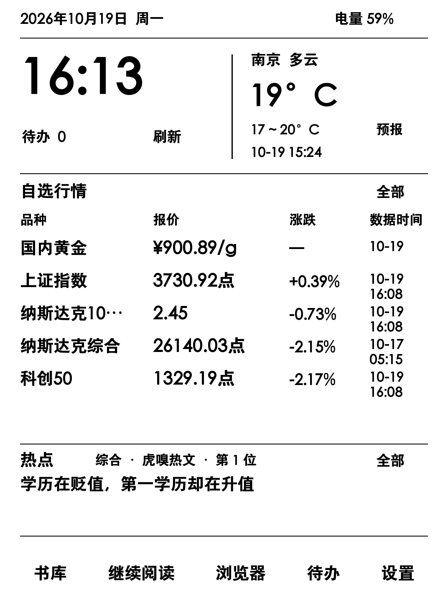

# Kindle Dashboard

让 Kindle 不只用来看书，也成为一块日常信息看板。

基于 Lua / LuaJIT 和 KOReader 的 Kindle 自定义首页：把时间、天气、自选行情和热点放在一屏，同时保留书库与继续阅读入口。



## 最近更新 · 2.53

- **横屏支持**：在“设置 → 看板方向”切换；天气、行情、热点、日历等看板页面，以及从看板进入的书库、搜书和阅读统一朝向。
- **切换与输入优化**：修复书库横屏方向相反，适配横屏搜书键盘，减少返回看板时的旧触摸事件误触。
- **行情排版调整**：首页行情、行情详情与自选管理增加行距和留白，保留原有粗体、字号及每页 6 项的容量。

完整变动与验证范围见 [更新日志](CHANGELOG.md)。以上更新已合入 `main`；安装包版本请以 [Releases](https://github.com/WYK12/kindle-dashboard/releases) 页面为准。

## 功能

- **首页看板**：大字时钟、天气、自选行情、热点轮换；看板各页可切换横竖屏，横屏首页采用左侧行情、右侧热点布局。
- **快捷阅读**：书库、继续阅读；书籍和文章阅读页右上角可直接返回看板，左上角保留返回列表入口。
- **热点新闻**：虎嗅热文和澎湃热榜，点击后获取公开正文，不提前下载文章。
- **天气与日历**：天气详情、未来预报、逐小时天气，点击首页日期查看月历。
- **日常工具**：待办、浏览器入口、自选行情调整顺序。
- **墨水屏适配**：大字加粗、简洁按钮、较大的点击范围、时钟局部刷新；横屏搜书使用宽输入框与紧凑键盘，完整显示候选和操作按钮。
- **常显与输入**：支持首页常显；空闲时等待触摸事件，减少后台空转。
- **背光控制**：设置中可一键关闭背光；Paperwhite 3 的硬件亮度归零，避免原生最低档仍有微光。
- **合并更新**：天气、行情、热点在共同时间窗口检查到期任务；内容未变不重绘，失败类别延长自动重试间隔，手动更新仍可立即重试。
- **USB 保护**：看板或受管阅读器运行时，插入电脑仅充电；退出到原生首页后可恢复文件传输。

## 当前支持范围

这是一个基于实际设备逐步打磨的实验性首发版本，目前只验证了下面这套环境：

| 项目 | 已验证环境 |
| --- | --- |
| 设备 | Kindle Paperwhite 3 |
| 系统 | 5.14.3.0.1，已越狱 |
| KOReader | v2026.07.1，已安装中文键盘数据和 FBInk |
| 启动环境 | KMC 提供的 `/mnt/us/kmc/kpm/packages/koreader/launch.sh` |
| 屏幕 | 1072 × 1448，BB8，行跨度 1088 |
| 字体 | 系统内置 `/usr/java/lib/fonts/STHeitiBold.ttf` |

当前代码使用 ARMv7 32 位输入事件结构，首页布局和显示参数也是按上述设备编写。其他型号、系统或 KOReader 安装方式需要适配，不能直接视为兼容。

看板各页均支持横屏（1448 × 1072）：天气、行情、自选管理、热点、日历、待办、设置及输入键盘统一跟随方向设置。从看板进入的书库、搜书、书籍与文章阅读均跟随同一方向，返回时朝向一致；单独启动 KOReader 不受本项目方向设置影响。切换入口：设置 → 看板方向；切换立即生效，示例配置默认竖屏。

阅读页快捷按钮目前覆盖看板生成的文章和本地 EPUB / MOBI 等可重排书籍。PDF 保留原有菜单返回入口，避免遮挡固定版面的内容。

## 安装

请先阅读 **[安装与恢复说明](INSTALL.md)**。项目包含自定义 KOReader 启动脚本、两个插件及三个补丁，需要按说明合并安装。

- 已安装 KOReader 和 KMC 的用户：下载 [Releases](https://github.com/WYK12/kindle-dashboard/releases) 中的安装包。
- 从源码安装：`src/mydash_v2` 和 `src/koreader` 分别对应 Kindle 根目录下的同名目录，配置使用 `*.example.json` 初始化。
- 本仓库不包含 KOReader 二进制、系统字体、电子书、文章正文、SSH 凭据或设备阅读记录。

## 数据与更新

| 内容 | 当前默认行为 |
| --- | --- |
| 时钟 | 每分钟更新 |
| 自选行情 | 每 5 分钟获取，可在界面调整 |
| 热点榜 | 每 10 分钟获取，首页每 3 分钟轮换一条 |
| 天气 | 每 30 分钟获取，可在设置调整 |
| 文章正文 | 仅点击文章时获取，已有本地缓存直接打开 |

天气来自 Open-Meteo；行情使用代码中配置的公开站点；热点来自虎嗅和澎湃的公开页面或接口。这些服务不由本项目维护，可能延迟、改版或暂时不可用。失败时会尽量保留已有缓存及数据时间，行情也可能是延时或历史快照。

常显会持续消耗电量。事件等待优化降低了短时测试中的 CPU 开销，但尚未做完整的续航对比测试。

## 源码结构

```text
src/
  mydash_v2/                 首页、渲染、触摸、天气、行情、热点与启动脚本
  koreader/
    koreader.sh             包含受管阅读器返回与 USB 保护的修改版启动脚本
    plugins/                书库与文章阅读集成
    patches/                字体与受管常显行为
tests/                      可重复运行的核心检查
scripts/build_release.py    生成不含设备数据的安装 ZIP
```

测试方法见 [tests/README.md](tests/README.md)。公开目录使用示例配置；运行生成的缓存、日志、阅读记录及个人配置不加入版本管理。

## 参与

欢迎通过 [Issues](https://github.com/WYK12/kindle-dashboard/issues) 反馈问题或提交适配。请附上设备型号、固件版本、KOReader 版本、操作步骤和能复现问题的界面截图。上传日志前请移除个人信息。

目前优先完善机型适配、安装流程和不影响操作体验的省电策略。

## 致谢与协议

感谢 [KOReader](https://github.com/koreader/koreader)、[FBInk](https://github.com/NiLuJe/FBInk) 及相关开源项目。

本仓库按 **AGPL-3.0** 发布，见 [LICENSE](LICENSE) 与 [THIRD_PARTY_NOTICES.md](THIRD_PARTY_NOTICES.md)。外部新闻、书籍和行情内容不随项目分发，其权利不因代码开源而改变。
